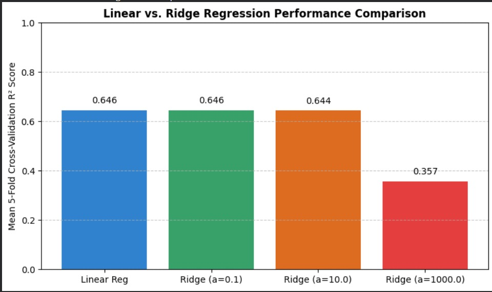

## SC5002 Lab Assignment 1 Part 2
by M Sabarieshwar

---

### Task 2.1: Loading California Housing Dataset
The California housing dataset was loaded and sampled to 1,000 records with a random state of 42. 

**First 5 rows of the dataset:**
| Index | MedInc | HouseAge | AveRooms | AveBedrms | Population | AveOccup | Latitude | Longitude | MedHouseVal |
| :--- | :--- | :--- | :--- | :--- | :--- | :--- | :--- | :--- | :--- |
| **20046** | 1.6812 | 25.0 | 4.192201 | 1.022284 | 1392.0 | 3.877437 | 36.06 | -119.01 | 0.47700 |
| **3024** | 2.5313 | 30.0 | 5.039384 | 1.193493 | 1565.0 | 2.679795 | 35.14 | -119.46 | 0.45800 |
| **15663** | 3.4801 | 52.0 | 3.977155 | 1.185877 | 1310.0 | 1.360332 | 37.80 | -122.44 | 5.00001 |
| **20484** | 5.7376 | 17.0 | 6.163636 | 1.020202 | 1705.0 | 3.444444 | 34.28 | -118.72 | 2.18600 |
| **9814** | 3.7250 | 34.0 | 5.492991 | 1.028037 | 1063.0 | 2.483645 | 36.62 | -121.93 | 2.78000 |

---

### Task 2.2: Training Linear and Ridge Regression
Standardization (`StandardScaler`) was applied to the features before splitting the dataset into an 80-20 train-test partition. Cross-validation was performed using 5 folds to evaluate model performance ($R^2$ score).

* **Linear Regression Mean 5-Fold $R^2$ Score:** 0.6457
* **Ridge Regression ($\alpha = 0.1$) Mean 5-Fold $R^2$ Score:** 0.6457
* **Ridge Regression ($\alpha = 10.0$) Mean 5-Fold $R^2$ Score:** 0.6443
* **Ridge Regression ($\alpha = 1000.0$) Mean 5-Fold $R^2$ Score:** 0.3574

---

### Task 2.3: Generating Model Comparison Chart
A performance comparison chart was generated to visualize the mean 5-fold cross-validation $R^2$ scores across the baseline Linear Regression model and various Ridge Regression regularizations.

